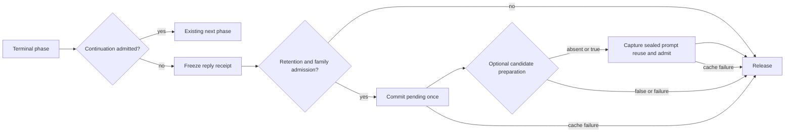

# Completed-turn retention

Completed-turn retention is an explicit **default-OFF library policy** in the
shared `SessionRuntime` and existing `PrefixCache`. It adds no HTTP fields,
queue, sampler, family implementation or execution loop. Ordinary prompt-cache
policy, aggregate callers and default HTTP/SSE/receipt behavior remain intact.
The mutable host tests establish shared lifecycle behavior only. Real Gemma host
continuation, turn-commit and turn-cache integration tests are registered centrally
against the production engine. Real Gemma4 ApiService two-turn fixtures also
inspect retention in the common owner. Native compiler/link, distributed state,
model fidelity, capacity and performance qualification remain open.

## Activation and producer requirements

Set `session::Policy::completed_turns=true`, `enabled=true`, a finite positive
`max_bytes`, positive `max_entries`, and LRU eviction. Set `store=false` to permit
lookups while refusing new retention. Both legacy byte exemptions
(`retain_one_oversize`, `charge_token_bytes=false`) are ineffective for the RAM
bound while this mode is selected. `UINT64_MAX` is not an explicit turn budget.

The adapter must advertise the additive `Capabilities::turn_commit`, implement
`Engine::commit_pending(KvHandle&)`, and supply complete `KvStore`
`capture_prompt`/`restore_prompt` hooks. This capability is independent of
`prefix_cache`; a producer can support completed-turn reuse and decline the
older ordinary prompt/chunk route. In completed-turn mode the runtime selects
only prompt-reuse turn checkpoints and skips its legacy ordinary resume-cache
route, including on a miss; a previous request's sampler cannot enter through
fallback. Existing ordinary aggregate owners and default mode are unchanged.
The shared control-turn route remains off:
MiniMax keeps its bounded native planner ownership and paired-state admission.
There is no scalar substitute for its native plan.

Supply `SessionHooks::identity`, `turn_cache` and `turn_checkpoint`:

```cpp
session::Policy policy;
policy.completed_turns = true;
policy.max_bytes = 64 * 1024 * 1024;
policy.max_entries = 8;
// Hooks are library integration points, not request wire fields.
// turn_cache(view) -> optional<SessionTurnCache>:
//   {{conversation, template_id, ordered_topology, optional_keep}, payload_bound}
// turn_checkpoint(view, reason) -> bool:
//   final phase, successful/quiescent lane, complete prompt-reuse producer,
//   physical/capture headroom and arithmetic admission all confirmed.
// Optional turn_snapshot(view) -> bool:
//   prepare the prompt-reuse candidate AFTER successful commit/frontier checks.
```

`turn_cache` runs after `opened` and its owning metadata is frozen for that lane.
It must not infer identity from family-owned `session`/`session_id` wire strings.
`max_state_bytes` is a conservative upper bound on **all** retained rank payloads
at completion, including attention, recurrent matrices, convolution, draft,
n-gram/history and any hidden context or retained allocation needed by reuse.
Zero is unknown and refuses retention before final-phase admission, commit or
capture. A nonzero underestimated bound causes a cache failure after capture,
never silent undercharge. The family separately admits transient capture/restore
peaks and synchronous work bounds.
The shared layer cannot inspect erased allocations or qualify producer estimates.

## Successful-turn state graph



Only a successful final stop, length or context boundary enters sealing, after
continuation declines and before release. No-store, disabled/unsupported mode,
unknown identity, insufficient budget, cancellation/disconnect, publication
failure, incomplete thinking or a family admission refusal skips the operation.
The family hook must decline an incomplete thinking phase even if its allowance
ran out. Zero output allowance and a supported lane without pending state may
seal an already complete prompt; they cause no extra model row or selection.

`commit_pending` is synchronous and quiescent. It evaluates the already published
pending anchor through the existing family forward path exactly once, without
`resume_lane`, selecting/publishing output or drawing target RNG. Consumed grows
by one iff pending existed; success leaves no pending anchor and coherent complete
family state. Generated IDs, terminal status, seed and selection cursors stay
unchanged. Repeating on a supported sealed lane is a no-op. It grants no further
decode, append or resume permission. Empty prefill/append remain no-ops.
Unsupported adapters throw `std::invalid_argument` even for an empty lane.
Invalid, stale, foreign, poisoned, cancelled, failed or in-flight lanes refuse
before writes. Execution failure restores every attempted rank, including the
throwing rank, or poisons only lanes whose recovery failed.

Cancellation is rechecked before sealing, after sealing, after candidate
preparation and before cache admission;
observing it at any of those quiescent boundaries declines retention. The owner
calls sealing/preparation/capture once on the same owner, without retry or another
loop. `turn_checkpoint` remains the pre-commit admission hook. Optional
`turn_snapshot` runs only after successful commit and frontier validation, before
`capture_prompt`; false is ordinary cache refusal and an exception is a cache
failure. Neither changes the completed reply or its receipt. Absence preserves
producers that prepare their existing prompt candidate during sealing. A helper
that requires sealed state belongs in `turn_snapshot`, never `turn_checkpoint`. Only
`KvStore::capture_prompt` issues the reusable state; clearing a resume snapshot's
pending field or relabelling its purpose cannot authorize reuse. Restore targets
a fresh `opened` lane and initializes the **new job's** seed, sampler, draft and
selection policy/cursors. It must never replay the previous request's RNG.

## Identity, causal history and safe misses

`Identity::model` binds model and asset digests, `profile` binds the full
numerical/arithmetic profile, `state_format` binds the state schema/version, and
`ranks` binds rank count. `TurnMetadata::template_id` binds tokenizer, template
and rendering version; `topology` binds ordered rank layout. Each value must be
known and stable. `conversation` selects the library conversation namespace;
`keep` is optional retention protection and is not a numerical identity.
Unknown or mismatching values miss without erased-payload access.

The index uses the store-issued canonical causal token vector after sealing,
including generated answer/reasoning IDs and delimiters actually evaluated by
the producer. It never derives keys from visible text, output counts or prompt
concatenation. An edited history matches only an entire actually stored coherent
earlier checkpoint. The cache never truncates a hybrid snapshot to a divergent
intermediate row. Turn lookup checks conversation, template, topology and the
complete execution identity. Ordinary lookup cannot retrieve a turn entry.
KvStore additionally checks sealed provenance, purpose, domain/schema and rank
order before erased-payload hooks; a token match cannot bypass those checks.

## One retention budget and lifetime

`PrefixStateCache` owns the retained entry directory, LRU, reservations and
physical lifetime ledger. `session::PrefixCache` validates and queries that owner;
it has no owning entry list or eviction loop. `NamedStateCache` is a compatibility
facade over the same owner. Gemma4's production `SessionRuntime` uses it for prompt
snapshots and completed turns. MiniMax service construction injects one instance
into its resident-prefix runtime and named encoded-checkpoint cache.

Turn mode charges complete declared immutable payloads, token/rank indices,
provenance/control metadata, strings and the shared checkpoint envelope. All
arithmetic is checked. `bytes()` remains the facade's retained policy charge;
`PrefixStateCacheStats` separately reports immutable payloads, encoded host
bytes, metadata, reservations and total service commitments. Device snapshots
remain typed immutable owners; they are never copied into host byte buffers.
Resident certificates charge metadata only, since the slot already owns device
KV. Shared capture owners and pool extents count once physically. Outstanding
lookup owners and reservations stay charged after directory eviction.

The production service budget derives from the existing configured RAM budget,
without adding another full budget per facade or reducing slots/context. Per-kind
byte/entry limits are quotas inside it. The legacy prompt-only sole-oversize and
prompt/named host-index/token-charge exemptions are explicit policies; exempt metadata is
still reported by `policy_exempt_bytes` and `service_bytes`. A sole oversize
prompt replaces the retained entry even when an active producer still borrows
the evicted capture. Its backing remains charged; `legacy_live_over_budget_bytes`
reports the excess and the existing producer must admit its transient peak.
This exemption governs legacy retained prompts, never strict turn sealing or
strict turn limits. It cannot bypass checked physical/metadata sums, including
evicted captures still held by a caller. Completed turns never use those exemptions.
Unlimited legacy settings allocate no eager slab.
Named vectors become immutable pool backing without a second payload copy;
codec capacity/slack, rather than just encoded length, consumes physical credits.
An already attached slab remains fully committed, including free ranges. Typed
snapshots and adopted encoded extents must fit its remaining metadata reserve;
free slab ranges cannot fund a second outside allocation. Its total commitment
stays B. This guard does not widen Qwen automatic reuse qualification.
The existing named capture/restore peak of six payloads and physical headroom
remains admitted before work, with working credits held by the common owner.
Completed-turn credits are reserved before pending-token consumption or copying.
The family additionally validates its transient device headroom and work bound.

Each conversation has at most one retained completed-turn entry. Successful
replacement refreshes insertion/use order. All new metadata and directory control storage
are frozen/allocated before prior entries are removed. Invalid, oversize or
protected-budget refusals preserve every previous entry. Eviction chooses the
least recently used unprotected entry, subject to the common RAM and entry caps.

A nonempty `keep` names a protected entry within these same caps. A protected
entry cannot be evicted or replaced, including by its own conversation or a
second use of its keep name. When protected entries exhaust the budget, admission
refuses. `PrefixCache::unpin(name)` (or the owner-thread library method
`SessionRuntime::unpin_turn_cache(name)`) explicitly removes protection while retaining
the snapshot and its conservative charge. It then becomes replaceable/evictable.
Protection lasts until unpin or owner destruction; there is no automatic expiry,
unlimited pin pool or silent keep eviction. Lookup owners remain immutable and
can outlive eviction; library callers must bound their own borrowed ownership.

## Failure reporting and verification

A miss and a refused admission are ordinary cache outcomes. A false prompt restore
is a miss and leaves a fresh lane untouched. A throwing restore fails the new
request, reports no hit/cached tokens and poisons/releases the destination; partial
physical state never becomes a hit. Metadata/provenance mismatches must not call
erased-payload hooks. `SessionCacheStats` reports `turn_admitted`, `turn_refused`,
`turn_failed` and `restore_failed` in addition to existing totals. Turn hits are
counted only after successful restoration. Legacy prompt statistics are preserved.

Sealing/preparation/capture/admission failures are cache failures after delivery. They preserve
the frozen reply receipt, emitted IDs and finish status; no failed state enters
the cache. Release is still attempted. Failed cleanup after attempted finalization
quarantines capacity and counts a cache failure without converting the completed
reply into an error. Ordinary execution/restore failures retain existing error
handling. Metadata-hook failures decline caching without failing generation.

Central registration in `cmake/StrixSession.cmake` exposes `session_turn_cache`
through standalone runtime and root projects. Checks use always-active conditions,
including under `NDEBUG`:

```sh
cmake -S tests/session_runtime -B build/session-host -DBUILD_TESTING=ON
cmake --build build/session-host --config Debug
ctest --test-dir build/session-host -C Debug --output-on-failure
```

The new test executes mutable multi-slot/two-rank attention, recurrent, conv,
draft and history state; repeated/edited history; final thinking continuation;
EOS/length/context/zero allowance; consume/capture/restore failures, throwing-rank
rollback and quarantine; post-commit candidate refusal/throw/cancellation and
staleness; zero-bound pre-work refusal versus nonzero underdeclaration;
source/bystander isolation; budget LRU/replacement/keeps; and two-turn production
HTTP handling against a cold reference. The independent legacy default HTTP/SSE/
receipt replay and frozen family fixtures remain separate and unchanged.

The common host suite checks mixed segmented/opaque/resident/named retention,
protected keeps, replacement, aliases, held leases, reservations, overflow and
allocation/restore failures. Real Gemma4 ApiService two-turn tests and MiniMax
service-construction/resident tests exercise the production adopters. Host results
do not qualify native compiler/link, fidelity, capacity/pressure or performance.
Archived compatibility replays and source-receipt audits retain their own failures
and qualification status.

This RAM slice leaves the family checkpoint codecs and durable IO as legacy
boundaries. The next slice unifies the existing checkpoint envelope and durable
lock/header/sections/checksum/fsync/atomic-publication writer with a production
adopter and legacy read adapters, then removes each migrated policy/IO path in
Gemma4 -> MiniMax -> Qwen -> DS41 -> GLM order. The one owner/frontend/cache/
checkpoint/durable-writer target is not complete. No native fork/COW, model
portability or wider reuse capability is established here.
